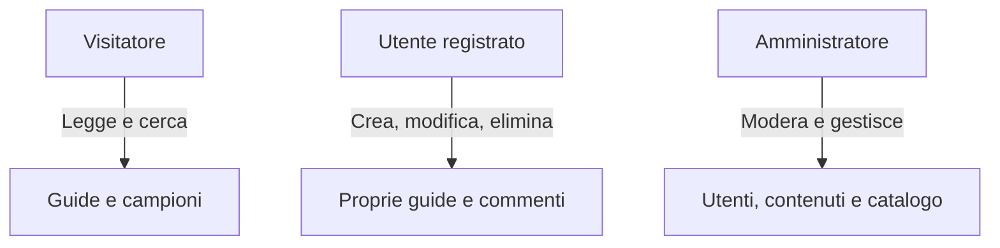

# ⚔️ Rift Academy — Guide e build per League of Legends


> **Rift Academy** è un sito dinamico e responsive per la community di League of Legends: guide, build e rune per ogni campione e ruolo, scritte dai giocatori. Progetto d'esame per il corso di **Tecnologie Web** dell'**Università degli Studi di Padova**.

---

## 📌 Indice
- [Descrizione del progetto](#-descrizione-del-progetto)
- [Tecnologie e architettura](#️-tecnologie-e-architettura)
- [Funzionalità e ruoli utente](#-funzionalità-e-ruoli-utente)
- [Grafica](#-grafica)
- [Struttura del repository](#-struttura-del-repository)
- [Sicurezza, accessibilità e SEO](#-sicurezza-accessibilità-e-seo)
- [Avvio in locale](#-avvio-in-locale)
- [Note per lo sviluppo](#-note-per-lo-sviluppo)
- [Installazione sul server del corso](#-installazione-sul-server-del-corso)
- [Prima della consegna](#-prima-della-consegna)
- [Credenziali di test](#-credenziali-di-test)

---

## 📖 Descrizione del progetto

Rift Academy permette di:
- 📖 **leggere e scrivere guide** strategiche per ogni campione;
- 🛡️ **proporre build** di oggetti e rune;
- 🧭 **sfogliare le guide per ruolo** (Top, Jungle, Mid, Bot, Support) o cercarle per titolo e campione;
- 💬 **interagire** con la community tramite voti, commenti, preferiti e segnalazioni;
- ⚙️ **moderare i contenuti** da un pannello di amministrazione.

---

## 🛠️ Tecnologie e architettura

Contenuto, presentazione e comportamento sono separati:

| Livello | Tecnologia | Dettagli |
| :--- | :--- | :--- |
| **Struttura** | HTML5 semantico | Sintassi compatibile XML. Template in `templates/` con segnaposto `{{nome}}` riempiti da PHP. |
| **Presentazione** | CSS3 puro | Mobile first, CSS Grid e Flexbox, variabili in `:root`, nessun framework. |
| **Comportamento** | JavaScript vanilla | Validazione dei form lato client (miglioramento progressivo: il sito funziona anche senza JS). |
| **Backend** | PHP 7.3+ | Nessun framework. Sessioni, ruoli, CRUD. Con Docker gira su PHP 8.2. |
| **Database** | MySQL / MariaDB | InnoDB, utf8mb4, schema in terza forma normale (3FN). |

---

## 👥 Funzionalità e ruoli utente



### 1. 🌐 Visitatore
- **Home** con presentazione, ricerca, riquadri "Sfoglia per ruolo" e ultime guide.
- **Pagina Guide** (`search.php`): elenco di tutte le guide, ricerca per titolo o campione e filtro per corsia.
- **Catalogo campioni** filtrabile per ruolo.
- Lettura delle guide (strategia, oggetti, rune, voto medio) e dei commenti.

### 2. 👤 Utente registrato (`user`)
- Registrazione, login e logout.
- **Guide:** creazione, modifica ed eliminazione delle proprie guide.
- **Interazione:** commenti, un voto da 1 a 5 per guida (non sulle proprie), preferiti, segnalazioni di guide e commenti.
- **Profilo** con le proprie guide e i preferiti.

### 3. 🛡️ Amministratore (`admin`)
- **Moderazione:** segnalazioni aperte, eliminazione di guide e commenti.
- **Utenti:** sospensione (blocca il login ma conserva i contenuti), riattivazione, eliminazione.
- **Catalogo:** inserimento e modifica dei campioni e dei loro ruoli.

---

## 🎨 Grafica

- **Tema scuro** con accento oro (`#f2b53a`). Griglia di sfondo e bagliore dorato in un'unica immagine decorativa (`images/sfondo.webp`, 11 KB) impostata come sfondo nel CSS.
- **Font di sistema**, nessun file da scaricare: `Verdana, Geneva, Tahoma, sans-serif` per il testo (x alta, lettere ben distinte) e `Georgia, "Times New Roman", Times, serif` per i titoli. Ogni elenco è chiuso dalla famiglia generica, come indicato nelle slide.
- **Icone e logo originali** in SVG: `images/logo.svg`, `images/roles/` (un'icona per ruolo), `images/icons/`.
- **Immagini dei campioni** in due versioni: l'originale `.jpg` e una ridotta `-small.webp` (circa 15 KB) usata nelle card. La funzione `img_small()` in `includes/functions.php` sceglie la versione ridotta se esiste.
- **Layout:** in home, presentazione, ruoli e invito a scrivere a sinistra e "Ultime guide" a destra. Nel dettaglio guida, contenuto a sinistra e voto e azioni a destra. Su mobile tutto passa in una colonna, sempre nello stesso ordine del codice.

---

## 📂 Struttura del repository

```plaintext
Rift-Academy/
├── 📄 Dockerfile, docker-compose.yml   # Ambiente locale (Apache + PHP 8.2, MySQL 8)
├── 📄 build-order.md                   # Ordine seguito per completare i file
└── 📁 rift-academy/                    # Il sito (questa cartella va sul server)
    ├── 📄 index.php              # Home
    ├── 📄 champions.php          # Catalogo campioni con filtro per ruolo
    ├── 📄 search.php             # Elenco guide, ricerca e filtro per corsia
    ├── 📄 guide_detail.php       # Dettaglio guida, voti, commenti
    ├── 📄 404.php                # Pagina di errore
    │
    ├── 📄 login.php, register.php, logout.php
    ├── 📄 create_guide.php, edit_guide.php, delete_guide.php
    ├── 📄 profile.php            # Proprie guide e preferiti
    ├── 📄 comment_action.php     # Crea/elimina commento (solo POST)
    ├── 📄 rate_guide.php         # Voto 1-5 (solo POST)
    ├── 📄 favorite_toggle.php    # Aggiunge/rimuove preferito (solo POST)
    ├── 📄 report_content.php     # Segnalazione (solo POST)
    │
    ├── 📄 admin_dashboard.php    # Moderazione e segnalazioni
    ├── 📄 admin_users.php        # Gestione utenti
    ├── 📄 admin_champions.php    # Catalogo campioni
    │
    ├── 📄 .htaccess              # Codifica, 404, cache e compressione
    ├── 📁 includes/              # config.php, db.php, auth.php, functions.php
    ├── 📁 templates/             # header, footer e un template per pagina
    ├── 📁 css/                   # style.css (base e cellulare), desktop.css (tablet e computer), print.css (stampa)
    ├── 📁 js/                    # validation.js, nav.js
    ├── 📁 images/                # logo, roles/, icons/, champions/, items/, runes/
    └── 📁 sql/                   # schema.sql (tabelle) e data.sql (dati di esempio)
```

---

## 🔒 Sicurezza, accessibilità e SEO

### 🎨 Organizzazione del CSS
Tre fogli di stile, collegati in `templates/header.html` con l'attributo `media`:

| File | `media` | Contenuto |
| :--- | :--- | :--- |
| `css/style.css` | `screen` | Variabili, base, componenti e layout per **cellulare** (mobile first) |
| `css/desktop.css` | `screen and (min-width: 48em)` | Solo le regole che cambiano su **tablet e computer** (da 64em la home e il dettaglio guida passano a due colonne) |
| `css/print.css` | `print` | Foglio completo per la **stampa** |

Ogni file è commentato sezione per sezione. I punti di passaggio sono in `em`, quindi seguono lo zoom del testo.

### 🛡️ Sicurezza
- **Prepared statement** PDO in tutte le query (niente SQL injection). Nelle ricerche `LIKE` i caratteri `%` e `_` vengono resi innocui.
- **Escape in output** con `e()` (`htmlspecialchars`) ogni volta che si stampa un dato inserito da un utente (niente XSS).
- Password con `password_hash()` / `password_verify()`.
- **Autorizzazione lato server** su ogni modifica o cancellazione: autore o admin, altrimenti HTTP 403.
- **Token CSRF** in tutti i form POST, `session_regenerate_id()` al login, cookie di sessione `HttpOnly` e `SameSite=Lax`, login bloccato per gli utenti sospesi.

### ♿ Accessibilità (obiettivo WCAG 2.2 AA)
- Landmark semantici, un solo `h1` per pagina, titoli in ordine, `aria-current="page"` sulla voce di menu attiva.
- Link **"Salta al contenuto"**: è il primo elemento raggiungibile con Tab e compare quando riceve il focus.
- Navigazione completa da tastiera, focus sempre visibile (anello oro, contrasto 10:1), ordine visivo uguale all'ordine del codice.
- **Contrasti verificati:** testo almeno 4.5:1, bordi dei campi e focus almeno 3:1. Link sottolineati, link visitati di un altro colore.
- **Lingua:** pagina in `lang="it"`, termini inglesi marcati con `<span lang="en">` (rank, build, community, patch, matchup, wave) per una pronuncia corretta con lo screen reader.
- Form con etichette visibili, errori collegati ai campi (`aria-invalid`, `aria-describedby`), messaggi in `role="status"` / `role="alert"`.
- Immagini decorative con `alt=""`, immagini informative con `alt` descrittivo. Moduli "Segnala" in `<details>` nativi.
- Reflow a 320 px senza scroll orizzontale, zoom fino al 400%, `prefers-reduced-motion`, modalità ad alto contrasto di Windows (`forced-colors`), foglio di stampa dedicato.

### ⚡ Prestazioni e SEO
- `title`, `meta description` e `meta keywords` per ogni pagina, con valori di riserva in `render_page()`.
- Nessun font da scaricare, immagini ridotte in WebP, `loading="lazy"` sulle immagini fuori schermo, cache e compressione nel `.htaccess`.
- **Lighthouse** sulla home: mobile 100 / 100 / 100 / 100, desktop 100 / 100 / 100 / 100 (Performance / Accessibilità / Best practice / SEO). Il test va fatto in una finestra in incognito: le estensioni del browser falsano i risultati.

---

## 🚀 Avvio in locale

### Opzione A — Docker (consigliata)

Su Windows bastano due doppi clic nella cartella del progetto:
1. `scarica-immagini.bat` (solo la prima volta): scarica le splash art dei campioni da Data Dragon.
2. `avvia-sito.bat`: avvia Docker e apre il sito nel browser.

Oppure, da terminale:

```bash
git clone https://github.com/paolopreve/Rift-Academy.git
cd Rift-Academy
docker compose up --build
```

Apri **http://localhost:8081**. Al primo avvio MySQL importa da solo `sql/schema.sql` e `sql/data.sql`. Le credenziali del database arrivano da `docker-compose.yml`, quindi non serve toccare `config.php`.

Per ripartire con un database pulito: `docker compose down -v` e poi di nuovo `docker compose up`.

### Opzione B — XAMPP / WAMP

1. Crea un database `rift_academy` e importa prima `rift-academy/sql/schema.sql`, poi `rift-academy/sql/data.sql`.
2. Imposta le credenziali in `rift-academy/includes/config.php`:
   ```php
   define('DB_HOST', 'localhost');
   define('DB_NAME', 'rift_academy');
   define('DB_USER', 'root');
   define('DB_PASS', '');
   ```
3. Copia la cartella `rift-academy` in `htdocs` e apri `http://localhost/rift-academy/`.

> [!WARNING]
> Ora `config.php` ha `DB_NAME` impostato a `mysql`, che è il database di sistema di MySQL: con XAMPP va cambiato in `rift_academy`. Con Docker non serve, perché vince la variabile d'ambiente.

---

## 🧰 Note per lo sviluppo

### HTML compatibile XML
- Tag in minuscolo e sempre chiusi: `<br />`, `<input ... />`, ``.
- Attributi tra virgolette; quelli booleani hanno un valore: `required="required"`.
- `&` scritto `&amp;` negli URL dentro gli attributi.
- Niente `style=""`, `onclick=""`, `<style>` o `<script>` con logica nel markup: CSS e JS stanno solo nei file esterni.

### Convenzioni
- Solo **percorsi relativi** (`css/style.css`, mai `/css/style.css`).
- Codice compatibile **PHP 7.3**: niente `match`, `str_contains`, `?->` e altre funzioni di PHP 8.
- Commenti e testi per l'utente in italiano.
- Nuove immagini dei campioni: aggiungi anche la versione `nome-small.webp` (larga 480 px) accanto al `.jpg`.

### Ruoli dei campioni
I dati di Riot (Data Dragon) non contengono i ruoli di corsia: si assegnano da `admin_champions.php`.

### Nota legale
Nomi e immagini dei campioni appartengono a Riot Games. Il footer riporta che Rift Academy non è approvata né sponsorizzata da Riot Games.

---

## 🌐 Installazione sul server del corso

Il sito va su `tecweb.studenti.math.unipd.it`, nella home di uno dei componenti del gruppo. Si carica **solo** la cartella `rift-academy/`.
- Verifica le **versioni** di PHP e MySQL con una pagina di prova.
- Imposta le credenziali reali in `includes/config.php`.
- **Permessi:** file `644`, cartelle `755`.
- Per la 404 personalizzata, sostituisci il percorso nel `.htaccess` e togli il commento.

---

## ✅ Prima della consegna

- [ ] Installazione da zero partendo dal dump del database
- [ ] Validazione W3C di tutte le pagine (HTML e CSS)
- [ ] Prova solo da tastiera, zoom al 400%, screen reader (NVDA) e controllo dei contrasti
- [ ] Nessun `TODO` rimasto (ora resta solo in `js/nav.js`)
- [ ] Credenziali di test funzionanti e riportate nella prima pagina della relazione
- [ ] Zip per Moodle con sorgenti, dump del database (schema + dati) e `relazione.pdf`

---

## 🔑 Credenziali di test

> [!NOTE]
> Sono gli utenti creati da `sql/data.sql`. Se cambi le password, aggiorna anche questo file.

| Ruolo | Username | Password | Permessi |
| :--- | :--- | :--- | :--- |
| **Amministratore** | `admin` | `Admin2026!` | Moderazione, utenti e catalogo |
| **Utente** | `utente` | `User2026!` | Guide proprie, commenti, voti, preferiti |

`data.sql` crea anche tre utenti di esempio (`baronpit`, `wardbot`, `zaunite`, password `User2026!`), 19 campioni e 20 guide in italiano (4 per ruolo), con commenti, voti e segnalazioni.

---

## 👨‍💻 Autori

Progetto per l'insegnamento di **Tecnologie Web** — **Università degli Studi di Padova**, A.A. 2026/2027.

- [@paolopreve](https://github.com/paolopreve)
- [@ericrosso](https://github.com/ericrosso)
