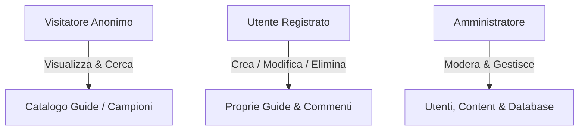

# TechWeb
# ⚔️ Rift Academy — League of Legends Guide & Build Portal


> **Rift Academy** è una piattaforma web dinamica e responsive progettata per la community di League of Legends. Sviluppata come progetto d'esame per il corso di **Tecnologie Web** presso l'**Università degli Studi di Padova**.

> [!NOTE]
> **Stato del progetto:** il repository contiene lo scheletro completo (pagine, controlli di accesso, template, schema del database). La logica di ogni pagina è ancora da completare: cerca `TODO` nei file per vedere cosa manca. Rimuovi questa nota a lavoro finito.

---

## 📌 Indice
- [Descrizione del Progetto](#-descrizione-del-progetto)
- [Tech Stack & Architettura](#-tech-stack--architettura)
- [Funzionalità & Ruoli Utente](#-funzionalità--ruoli-utente)
- [Struttura del Repository](#-struttura-del-repository)
- [Sicurezza & Accessibilità](#-sicurezza--accessibilità)
- [Guida all'Installazione](#-guida-allinstallazione)
- [Note per lo Sviluppo](#-note-per-lo-sviluppo)
- [Installazione sul Server del Corso](#-installazione-sul-server-del-corso)
- [Prima della Consegna](#-prima-della-consegna)
- [Credenziali di Test](#-credenziali-di-test)

---

## 📖 Descrizione del Progetto

Rift Academy offre agli appassionati di League of Legends un ambiente interattivo per:
- 📖 **Consultare e creare guide** strategiche complete per ogni campione.
- 🛡️ **Pianificare build** ottimizzate per item e rune.
- 💬 **Interagire** con la community tramite voti, commenti, preferiti e segnalazioni.
- ⚙️ **Moderare i contenuti** tramite un pannello di amministrazione dedicato.

---

## 🛠️ Tech Stack & Architettura

Il progetto segue una rigida **architettura a tre livelli** per garantire la completa separazione tra contenuto, presentazione e comportamento:

| Livello | Tecnologia | Dettagli di Implementazione |
| :--- | :--- | :--- |
| **Frontend** | HTML5 Semantico | Accessibilità elevata, struttura valida XML / HTML5. Template HTML con segnaposto `{{nome}}` riempiti da PHP. |
| **Styling** | CSS3 (Pure) | Flexbox & CSS Grid responsive, zero framework esterni. |
| **Client Script** | Vanilla JS | Validazione form lato client, dinamismo ed elementi UX. |
| **Backend** | PHP (7.4+) | Operazioni CRUD, gestione sessioni e ruoli utente. |
| **Database** | MySQL / MariaDB | Struttura relazionale progettata in **Terza Forma Normale (3FN)**. |

---

## 👥 Funzionalità & Ruoli Utente



### 1. 🌐 Visitatore (Anonimo)
- Esplorazione della **Home Page** con guide in evidenza.
- **Ricerca testuale** su guide e campioni.
- Consultazione del **catalogo campioni** filtrabile per ruolo (*Top, Jungle, Mid, Bot, Support*).
- Lettura dei dettagli delle guide e dei commenti.

### 2. 👤 Utente Registrato (`user`)
- **Autenticazione:** Registrazione, Login e Logout sicuri.
- **Operazioni CRUD:**
  - **Create:** Pubblicazione di nuove guide con campi di testo libero per le strategie.
  - **Update:** Modifica delle proprie guide pubblicate.
  - **Delete:** Cancellazione delle proprie guide.
- **Interattività:** Commenti in testo libero, valutazione delle guide altrui (una per guida), guide preferite e segnalazione di contenuti inappropriati.

### 3. 🛡️ Amministratore (`admin`)
- **Dashboard Riservata:** Accesso al pannello di controllo amministrativo/gestionale.
- **Moderazione:** Eliminazione immediata di contenuti inappropriati o offensivi e gestione delle segnalazioni ricevute.
- **Gestione Utenti:** Sospensione (blocco del login), riattivazione ed eliminazione degli account.
- **Gestione Game Data:** Inserimento e aggiornamento dei campioni, degli oggetti e delle rune nel database.

---

## 📂 Struttura del Repository

Tutte le pagine stanno nella radice, così i link relativi restano semplici.

```plaintext
rift-academy/
├── 📄 index.php              # Home: ultime guide e ricerca rapida
├── 📄 champions.php          # Catalogo campioni e filtri per ruolo
├── 📄 guide_detail.php       # Dettaglio guida, voti e commenti
├── 📄 search.php             # Risultati della ricerca testuale
├── 📄 404.php                # Pagina di errore personalizzata
│
├── 📄 login.php              # Accesso
├── 📄 register.php           # Registrazione
├── 📄 logout.php             # Logout (solo POST)
├── 📄 create_guide.php       # Form creazione guida (campo testo libero)
├── 📄 edit_guide.php         # Modifica guida (autore o admin)
├── 📄 delete_guide.php       # Eliminazione guida (solo POST)
├── 📄 profile.php            # Proprie guide e preferiti
├── 📄 comment_action.php     # Crea/elimina commento (solo POST)
├── 📄 rate_guide.php         # Valutazione 1-5 (solo POST)
├── 📄 favorite_toggle.php    # Aggiunge/rimuove preferito (solo POST)
├── 📄 report_content.php     # Segnalazione contenuto (solo POST)
│
├── 📄 admin_dashboard.php    # Moderazione guide, commenti e segnalazioni
├── 📄 admin_users.php        # Sospensione/eliminazione utenti
├── 📄 admin_champions.php    # Catalogo campioni, oggetti e rune
│
├── 📄 .htaccess              # Pagina 404 e codifica (vedi commenti nel file)
├── 📁 includes/              # Codice PHP condiviso
│   ├── config.php            #   credenziali del database
│   ├── db.php                #   connessione PDO
│   ├── auth.php              #   sessione, ruoli, token CSRF
│   └── functions.php         #   escape, messaggi, render_page()
├── 📁 templates/             # HTML con segnaposto {{nome}}: header, footer e una pagina per file PHP
├── 📁 css/                   # style.css (layout responsive), print.css (stampa)
├── 📁 js/                    # validation.js (validazione client), nav.js (UX)
├── 📁 img/                   # logo.svg, champions/, items/, runes/ (immagini in locale)
├── 📁 sql/                   # schema.sql (tabelle) e data.sql (ruoli e utenti di test)
├── 📁 tools/                 # Strumenti locali, NON da caricare sul server
│   └── import_datadragon.py  #   genera gli INSERT dei campioni da Data Dragon
└── 📄 relazione.pdf          # Documento di relazione per la consegna dell'esame
```

---

## 🔒 Sicurezza & Accessibilità

> [!IMPORTANT]
> Il progetto rispetta appieno le linee guida e le specifiche del corso di Tecnologie Web.

- **🛡️ Sicurezza Backend:**
  - **Prepared Statements** (PDO) per impedire attacchi **SQL Injection**.
  - **Escape in output** con `htmlspecialchars()` per la prevenzione di vulnerabilità **XSS** (si applica quando si stampa un dato inserito da un utente, non quando lo si salva).
  - Password salvate con `password_hash()` e verificate con `password_verify()`.
  - **Controllo di autorizzazione lato server** su ogni modifica o cancellazione (autore o admin): nascondere un pulsante non basta.
  - **Token CSRF** in tutti i form POST, `session_regenerate_id()` al login, cookie di sessione `HttpOnly` e `SameSite`, blocco del login per gli utenti sospesi.
- **♿ Accessibilità & UX** (obiettivo: WCAG 2.2 AA):
  - HTML nativo prima di ARIA, landmark semantici, link "Salta al contenuto" e un solo `h1` per pagina.
  - Piena navigabilità da tastiera con indicatore di focus sempre visibile.
  - Form con etichette visibili e messaggi di errore collegati ai campi (`aria-invalid`, `aria-describedby`).
  - Layout fluido e responsive (reflow a 320 px, zoom fino al 400%) per dispositivi mobile, tablet e desktop.
  - Rispetto di `prefers-reduced-motion` e foglio di stile dedicato alla stampa (`print.css`).
- **📑 SEO:** `title` e `meta description` unici per pagina, struttura dei titoli coerente, breadcrumb nelle pagine di dettaglio.

---

## 🚀 Guida all'Installazione

### Requisiti Preliminari
- Web Server (**Apache** o **Nginx**) con PHP 7.4 o superiore. Il codice richiede almeno PHP 7.3: verifica la versione sul server del corso.
- Server **MySQL / MariaDB** (InnoDB e FULLTEXT richiedono MySQL 5.6 o superiore).
- Ambiente locale consigliato: **XAMPP**, **WAMP** o **Docker**.

### Passaggi per l'esecuzione in locale

1. **Clona la repository:**
   ```bash
   git clone https://github.com/tuo-username/rift-academy.git
   cd rift-academy
   ```

2. **Importa il Database:**
   - Apri `phpMyAdmin` (o il tuo client MySQL).
   - Crea un database denominato `rift_academy_db`.
   - Importa prima `sql/schema.sql` e poi `sql/data.sql`.

3. **Configura la Connessione:**
   - Apri il file `includes/config.php` e imposta le tue credenziali locali:
     ```php
     define('DB_HOST', 'localhost');
     define('DB_USER', 'root');
     define('DB_PASS', '');
     define('DB_NAME', 'rift_academy_db');
     ```

4. **Avvia l'applicazione:**
   - Copia i file nella cartella `htdocs` (o root del web server) e apri `http://localhost/rift-academy`.
   - In alternativa, dalla cartella del progetto: `php -S localhost:8000` e apri `http://localhost:8000/`.

---

## 🧰 Note per lo Sviluppo

### Regole per i template HTML
La sintassi deve essere compatibile con XML, come richiesto dalle specifiche:
- tag in minuscolo e sempre chiusi: `<br />`, `<input ... />`, `<meta ... />`;
- attributi sempre tra virgolette; gli attributi booleani hanno un valore: `required="required"`;
- nessuno `style=""` e nessun `onclick=""` nel markup: CSS e JavaScript stanno solo nei file esterni.

### Ruoli dei campioni
I dati statici di Riot (Data Dragon) non contengono i ruoli di corsia (Top, Jungle, Mid, Bot, Support): vanno assegnati dalla pagina `admin_champions.php`.

### Catalogo di campioni
`tools/import_datadragon.py` genera `sql/champions_import.sql` con nomi, titoli e immagini (opzione `--images` per scaricarle in `img/champions/`). Lo script non è stato ancora testato: controlla l'output prima di importarlo.

### Nota legale
Nomi e immagini dei campioni appartengono a Riot Games. Il footer riporta il disclaimer che Rift Academy non è approvata né sponsorizzata da Riot Games.

---

## 🌐 Installazione sul Server del Corso

Il sito va installato su `tecweb.studenti.math.unipd.it`, nella home di uno dei componenti del gruppo. Verifica:
- **Versioni** di PHP e MySQL (vedi Requisiti Preliminari): conviene provarle con una pagina di prova nella prima settimana.
- **Permessi:** file `644`, cartelle `755`.
- **Solo link relativi** (`css/style.css`, mai `/css/style.css`).
- **Non caricare** la cartella `tools/`.
- Se vuoi la pagina 404 personalizzata, sostituisci il percorso nel file `.htaccess` e togli il commento.

---

## ✅ Prima della Consegna

- [ ] Installazione da zero partendo dal dump del database
- [ ] Validazione W3C di tutte le pagine
- [ ] Prova solo da tastiera, zoom al 400% e controllo dei contrasti
- [ ] Nessun `TODO` rimasto nei file
- [ ] Credenziali di test funzionanti (admin e user) e riportate nella prima pagina della relazione
- [ ] Zip per Moodle con sorgenti, dump del database (schema + dati) e `relazione.pdf`

---

## 🔑 Credenziali di Test

> [!NOTE]
> Credenziali predefinite fornite per la valutazione del progetto come da specifiche d'esame. Sono quelle create da `sql/data.sql`: se le cambi, aggiorna entrambi.

| Ruolo | Username | Password | Permessi |
| :--- | :--- | :--- | :--- |
| **Amministratore** | `admin` | `Admin2026!` | Accesso completo, moderazione e gestione DB |
| **Utente Semplice** | `utente` | `User2026!` | Creazione, modifica ed eliminazione delle proprie guide |

---

## 👨‍💻 Autori & Corso

Progetto sviluppato dal gruppo di lavoro per l'insegnamento di **Tecnologie Web**  
**Università degli Studi di Padova** — *Anno Accademico 2026/2027*